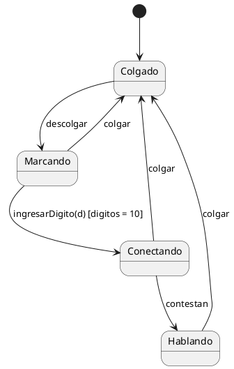
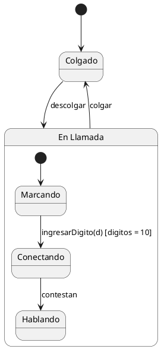

# Apunte Parcial Práctico 2026

> Versión actualizada (octubre 2026). El PDF original, con las imágenes, está en [`apunte.pdf`](apunte.pdf). Acá van el texto y las reglas; los diagramas de ejemplo se describen o se pasan a PlantUML.

A partir del 2026 solamente se rinde el parcial práctico del segundo cuatri. A continuación se detallan los temas y su manera de encararlos a la hora de la resolución.

**Hecho por:** Mateo Lopez, Agustin Carrasco y Lautaro Sandoval.

---

## Pasos para resolver

1. Primero se hace el [diagrama de casos de uso](#diagrama-de-casos-de-uso) de **todos** los casos de uso del escenario.
2. Se hace la [descripción de caso de uso](#descripción-de-caso-de-uso) indicado (ej: CU1).
3. Se hace la [realización del CU](#realización-del-caso-de-uso) con los siguientes elementos:
   1. [Diagrama de clases](#1---diagrama-de-clases) (de las clases involucradas en el caso de uso).
      * Al principio **no** pongo los métodos ni los atributos: los agrego **después** de hacer el diagrama de secuencia.
      * Termino el diagrama de secuencia y, en base a los métodos que ideé y usé ahí, por cada clase escribo sus métodos. Lo mismo con los atributos.
   2. [Diagrama de secuencia](#2---diagrama-de-secuencia) de ese caso de uso.
   3. [Tarjetas CRC](#3---tarjeta-crc) (de las clases utilizadas en el diagrama de clases de ese CU).
      * Esto va para lo último: ya hecho el diagrama de clases con los métodos del diagrama de secuencia, sale en un toque.
4. [Máquina de estados](#máquina-de-estados).
5. [Patrones de diseño](#patrones-de-diseño).

Extra: [diagrama de clases en Java](#diagrama-de-clases-en-java).

---

## Diagrama de Casos de Uso

Es un mapa visual que delimita los límites del sistema, quién interactúa con él (**Actores**) y qué funcionalidades de valor ofrece (**Casos de Uso**), sin entrar en el orden cronológico de las acciones.

```text
                    Sistema
              +-----------------+
   Actor 1 ---|----( CU1 )      |
          \---|----( CU2 )------|------> (Entidad)
              |                 |
   Actor 2 ---|----( CU3 )------|------- Actor externo
          \---|----( CU4 )      |
              +-----------------+
```

### Elementos clave

* **Actores:**
  * Son los que inician el caso de uso (actores del lado izquierdo).
  * Representan un rol externo al sistema, jamás un nombre propio (ej: *Cajero*, *Cliente*, *Administrador*; no *Juan Pérez*).
  * Pueden ser sistemas externos que envían o reciben datos (ej: *AFIP*).
  * Los actores del lado derecho suelen ser externos al sistema y actúan como soporte o receptores de información sin iniciar el caso de uso.
* **Casos de Uso (óvalos):** nombre `[Verbo en infinitivo] + [Sustantivo]` (ej: *Registrar Pedido*).
* **Asociación (línea sólida simple):** conecta al actor con el óvalo del caso de uso en el que participa. **No lleva flechas.**
* **Límite del Sistema (System Boundary):**
  * Un rectángulo grande con el nombre del sistema arriba.
  * **Regla de oro:** los casos de uso van adentro; los actores van siempre afuera.
  * La profe en clase por ahí lo saltea; hay que preguntar si lo usamos o no en el parcial. No creo que esté de más.

### Relaciones

| Relación | Cuándo se usa | Sentido de la flecha |
| :--- | :--- | :--- |
| `<<include>>` | Parte obligatoria o común que se extrae para reutilizar. Es por si el CU base **no puede completarse** sin este. | Línea punteada que apunta **hacia el caso de uso incluido** (`CU Base → CU Incluido`). |
| `<<extend>>` | Comportamiento opcional o condicional que ocurre bajo cierta regla/evento. | Línea punteada que apunta **hacia el caso de uso base** (`CU Extensión → CU Base`). |
| **Generalización (herencia)** | Un actor o caso de uso hereda el comportamiento de otro más general (ej: *Usuario Registrado* hereda de *Usuario*). | Línea sólida con flecha triangular hueca hacia el padre. |

### Errores típicos

* **Casos de uso "huérfanos":** dejar un óvalo sin conectar a ningún actor.
* **Conectar actores entre sí con líneas simples:** entre actores **solo** puede haber relación de generalización/herencia (flecha con punta hueca).
* **Descomposición funcional:** crear casos de uso para pasos individuales dentro de un proceso más grande (ej: *Validar Contraseña* o *Buscar Producto* como casos de uso aislados, en lugar de integrarlos dentro del flujo de *Iniciar Sesión* o *Registrar Venta*).
* **Invertir las flechas de include y extend:** el base **necesita/incluye** al otro; la extensión **le agrega algo** a la base. Por lo tanto, la flecha apunta al que se agrega.

---

## Descripción de Caso de Uso

En la **descripción textual** (o plantilla de caso de uso) se explica paso a paso la interacción entre el **actor** y el **sistema**.

1. **Actor:** el rol que inicia la acción (ej: *Cajero*).
2. **Precondición:** qué debe ser verdad en el sistema antes de empezar (ej: *El usuario debe estar autenticado en el sistema*).
   * Lo que se especifica en la precondición no se vuelve a indicar en el camino.
   * La precondición es independiente de si la acción ocurre en el camino estándar o en uno alternativo: si algo ya está garantizado por la precondición, tampoco se repite en los caminos alternativos.
   * Ej: Precondición: *Alumno autenticado*. No pongas: 1. Alumno ingresa usuario y contraseña. 2. El sistema valida usuario y contraseña. La autenticación ya ocurrió antes; por ende, el paso 1 también.
3. **Postcondición:** estado en el que queda el sistema tras completar el objetivo (ej: *La venta queda registrada y el stock actualizado*).
   * **OJO:** precondición y postcondición siempre se refieren al **sistema**, nunca a algo del usuario.
   * La postcondición **sólo se escribe si la ejecución produce un cambio de estado interno** en el sistema (ej: se registra una venta, se actualiza el stock). Si el caso de uso solo consulta o muestra información y no modifica nada, **no lleva postcondición**.
4. **Camino Estándar:** los pasos alternan entre **acción del actor** y **respuesta del sistema**.
   * La idea es que sea uno y uno: actor, sistema, actor, y así sucesivamente.
   * **Ingreso múltiple:** el actor no puede ingresar listas o estructuras de datos al sistema de una sola vez. La selección múltiple se modela de forma iterativa: el sistema muestra las opciones, el actor selecciona y envía un elemento, el sistema responde, y el ciclo se repite hasta que el actor indica que terminó.
   * Ej: *3. El sistema muestra las materias disponibles. 4. El actor selecciona una materia. 5. El sistema registra la materia y vuelve a mostrar las disponibles (se repiten los pasos 4 y 5 hasta que el actor confirma la inscripción).*
   * Usa lenguaje generalista: habla de *"ingresar datos"*, *"validar"*, *"solicitar confirmación"*.
   * **Nunca detalles técnicos ni de interfaz gráfica** (prohibido poner *"el usuario presiona el botón X"* o *"se ejecuta un INSERT en la tabla Y"*; se pone *"el actor confirma la operación"* o *"el sistema registra la venta"*).
5. **Caminos Alternativos:** los desvíos del camino feliz donde algo falla o se toma otra opción válida (ej: datos incorrectos, falta de stock, cancelación).
   * Todo camino alternativo debe indicar explícitamente si **vuelve** al flujo estándar (ej: *Retoma en el paso 3*) o si **termina** el caso de uso sin éxito (ej: *Fin del caso de uso*).
   * **Numeración:** si el desvío pasa en el paso 4, queda así:

     ```text
     4.a No hay evaluaciones pendientes
         1. El sistema informa que no encuentra evaluaciones pendientes para el alumno.
         2. Finalizar caso de uso / ir a paso X.
     ```

### Include en el CU

*(Sección pendiente de completar en el apunte original.)*

### Errores comunes a evitar

* **Olvidar al Actor:** todo caso de uso debe estar iniciado directa o indirectamente por un actor (humano, rol o sistema externo).
* **Mezclar diseño técnico con requerimientos:** hablar de pantallas, botones, tecnologías o bases de datos en la descripción del caso de uso.

---

## Realización del Caso de Uso

Se trabaja siempre sobre el caso de uso que fue seleccionado para su análisis y resolución.

### 1 - Diagrama de clases

En el diagrama de clases para una realización de caso de uso, el objetivo es representar exclusivamente las clases necesarias para ejecutar ese flujo específico:

* **Clases involucradas:** sólo las que colaboran para cumplir los pasos del Caso de Uso, incluyendo obligatoriamente la clase **Controlador** (orquestador del flujo) y la clase de **UI**, junto con las clases de dominio necesarias (nombre, atributos necesarios, métodos).
* **Relaciones:** define asociaciones, agregación/composición y herencia (generalización) entre las clases.

| Relación | Símbolo | Cuándo usarla |
| :--- | :---: | :--- |
| **Herencia (Generalización)** | `——▷` | Relación *"es un"* (Docente es una Persona). Hereda atributos y métodos. **No lleva multiplicidad** en los extremos. |
| **Composición** | `——◆` | El ciclo de vida de las partes depende del todo. Rombo relleno en el extremo del **"Todo"** (el contenedor o dueño). Se lee, del Todo a las Partes: *"está compuesto por…"* o *"posee exclusivamente como parte a…"*; de la Parte al Todo: *"forma parte de / pertenece a…"*. |
| **Agregación** | `——◇` | Rombo hueco en el extremo del **"Contenedor"**. Ciclo de vida independiente: los elementos contenidos pueden existir por fuera del contenedor y, si el contenedor se elimina o resetea, siguen existiendo en el sistema. Se lee: *"agrupa a…"*, *"contiene a…"* o *"está conformado por…"*. |
| **Asociación simple** | `——` | Relación estructural estándar entre dos entidades independientes. |
| **Dependencia** | `- - >` | Cuando un elemento depende de otro para su funcionamiento (ej: una clase usa a otra como parámetro). |
| **Realización** | `- - ▷` | Cuando una clase implementa una interfaz. |

* **Multiplicidad:** cuántos objetos participan en la relación (ej: `1`, `*`, `0..1`). Se lee **mirando el extremo opuesto**. Ejemplo (Cliente, Reserva, Pago): *Cliente tiene de 1 a muchas reservas, y Reserva pertenece a un solo Cliente; Cliente tiene 1 o varios pagos, y el Pago pertenece a un solo Cliente.*
* **Visibilidad:**

| Nivel | Símbolo | Definición |
| :--- | :---: | :--- |
| **public** | `+` | Cualquier clasificador externo con visibilidad hacia el clasificador dado puede utilizar la característica. |
| **protected** | `#` | Cualquier descendiente del clasificador puede utilizar la característica. |
| **private** | `-` | Sólo el propio clasificador puede utilizar la característica. |
| **package** | `~` | Sólo los clasificadores declarados en el mismo paquete pueden utilizar la característica. |

* **Alcance de instancia y estático:** no hace falta en práctica.
* **Clase DTO:** no se toma en práctica.

#### Clases UI, Controlador y Sistema

> Las clases **UI** y **Controlador** **no llevan atributos**.

* **UI:** componente responsable de la interacción con el usuario, sin involucrarse en las reglas del negocio. Métodos: recibir datos del actor; mostrar información (confirmaciones o errores); pedir datos o selecciones.
* **CTRL:** coordina la ejecución de un CU. Organiza la UI, el Sistema y las clases del dominio. Métodos:
  1. iniciar una acción del CU;
  2. recibe acciones de la UI;
  3. coordinar el flujo de acciones para realizar el CU;
  4. enviar mensajes al Sistema;
  5. recibe resultados y continúa el flujo;
  6. delega a la UI lo que hay que mostrar o pedir: estos mensajes **pueden llevar estructuras de datos como parámetros** (ej: `mostrarPrioridades(listaPrioridades)` para que la UI muestre la lista).
* **Sistema:** tiene una visión general de la información manejada por la aplicación. Conoce los conjuntos de objetos principales y realiza operaciones que necesitan acceder o afectar a esa información global. Métodos: mantiene/conoce los objetos que administra; busca objetos dentro de esos conjuntos; devuelve listas de objetos cuando se necesitan; realiza las altas de nuevos objetos; cálculos generales que involucran información del sistema.
* **Dominio:** conceptos, entidades o cosas que existen en el negocio (*Cliente*, *Producto*, *Materia*). Saben hacer cosas en base a su propia información. A diferencia de la UI y el Controlador, tienen **atributos** (información que define al objeto) y **métodos** (acciones que puede hacer o conocer).

#### Preguntas para hacerte con cada acción del enunciado

1. ¿Es una interacción con el actor? → **UI**
2. ¿Es coordinación del flujo del CU? → **CTRL**
3. ¿Necesita acceder al conjunto general, buscar, dar de alta o calcular globalmente? → **SISTEMA**
4. ¿Es información o comportamiento propio de un objeto concreto? → **Clase de dominio**
5. ¿Ese mensaje aparece llegando a la clase en el diagrama de secuencia? → **Tiene que estar como método en esa clase.**

#### Consejos clave

* **Alcance:** no incluir clases del sistema que no intervienen en el flujo del CU.
* **Foco en el comportamiento:** asegurar que los métodos invocados durante el flujo estén descriptos, ya que van a ser usados en el diagrama de secuencia.
* **Coherencia:** si una clase aparece en el diagrama, debe tener su tarjeta CRC.
* **Nombres en singular:** no uses nombres en plural para las clases (no `Pacientes`; escribí `Paciente`).

---

### 2 - Diagrama de secuencia

Es un modelo dinámico que representa el intercambio de mensajes entre objetos ordenado estrictamente por secuencia temporal (eje vertical). Muestra el sistema en tiempo de ejecución, evidenciando cómo las instancias colaboran para concretar el flujo exacto del Caso de Uso.

#### Orden visual (de izquierda a derecha)

1. **Actor:** quien inicia el flujo.
2. **Pantalla (`<<Boundary>>` o UI):** interfaz del actor. Recibe y muestra, sin lógica. Nombre: `UI[Nombre del CU]` (ej: `UIRealizarReserva`).
3. **Controlador de CU (`CTRLCU`):** el orquestador específico del caso de uso. Nombre: `CTRL[Nombre del CU]` (ej: `CTRLRealizarReserva`).
4. **Controlador de Sesión (`CTRLSesion`):** objeto preexistente que maneja el contexto y la seguridad.
5. **Sistema (`<<Sistema>>`):** fachada centralizadora de colecciones globales y operaciones.
6. **Colecciones y Entidades (`<<Entity>>`):** clases del dominio.
7. **Actor externo:** servicios de terceros (ej: pasarelas de pago). Siempre en el extremo derecho.

**IMPORTANTE:** todos los mensajes que llegan a una clase tienen que estar definidos como métodos de esa clase en el diagrama de clases.

#### Ciclo de vida y ejecución

1. **Línea de vida (lifeline):** línea vertical punteada descendente que indica la existencia del objeto.
2. **Foco de control (caja de activación):** rectángulo vertical sobre la línea de vida; el lapso en que el objeto tiene el control del procesamiento.
3. **Destrucción explícita (`X` o `destroy`):** marcador al final de la línea que indica eliminación definitiva.

#### Tips de resolución

##### 1. Cómo usar CTRLSesion y CTRLCU

* No solicitar al actor datos que el sistema ya conoce por su sesión, si en la precondición se marca que está logueado (`idUsuario`, `legajo`).
* El `CTRLCU` debe extraerlos consultando a `CTRLSesion` (ej: `obtenerUsuarioLogueado()`).
* A `CTRLSesion` no se le hace un mensaje `create`: ya es una instancia preexistente.

```plantuml
CTRLCU -> CTRLSesion: obtenerUsuario()
CTRLSesion --> CTRLCU: Usuario
```

##### 2. Cómo escribir mensajes

* **De CTRL a Sistema:** verbos de negocio (`obtenerEvento()`, `buscarDisponibles()`, `validarDisponibilidad()`). **Prohibido usar `get` a este nivel.**
* **De Sistema a Entidad:** getters formales de POO para consultar estados internos (`getNombre()`, `getCupo()`).
* **De Entidad a Entidad (colaboración):** un objeto puede pedir colecciones de datos a otros objetos asociados mediante getters (ej: `getPrestamos()` sobre un `Estudiante`).
* **De CTRL a UI:** el controlador puede enviar estructuras de datos como parámetro para que la UI las muestre (ej: `mostrarPrioridades(listaPrioridades)`).
* **De Actor a UI:** el actor **nunca** envía listas ni estructuras de datos. Si debe elegir varios elementos, se dibuja un `loop` donde envía uno por vez y el sistema responde en cada vuelta.

```plantuml
CTRLCU -> Sistema: obtenerEvento()
Sistema -> Eventos: getEvento()
Eventos --> Sistema: Evento
Sistema --> CTRLCU: Evento
```

* **Uso del SET:** sirve para (1) darle un valor a un atributo de un objeto y (2) setear asociaciones. Ejemplo: `Reserva` tiene que tener una asociación con `Pago`, `Evento` y `Cliente`, además de un asiento. **Los sets salen del Sistema siempre.**

```plantuml
create "r: Reserva" as r
Sistema -> r: Create()
Sistema -> r: SetEvento(e)
Sistema -> r: SetCliente(c)
Sistema -> r: SetPago(p)
Sistema -> r: SetAsiento(a)
```

  Si ya son muchos datos se puede hacer de la siguiente forma (según la profe): `Sistema -> n: SetDatos(Datos_Tratamiento)`, con una nota que aclare que `Datos_Tratamiento` representa todos los atributos de la clase (fecha, hora, frecuencia, dosis y observación) y la respuesta `Datos seteados`.

##### 3. Tipos de mensajes y sincronía

* **Síncronos (punta rellena y línea continua):** el emisor bloquea y espera respuesta. Es el estándar para llamadas internas del sistema.
* **Asíncronos (punta abierta y línea continua; la línea discontinua queda solo para los retornos):** el emisor no espera respuesta inmediata. **Uso obligatorio para comunicación con actores externos** debido a latencias de red.

##### 4. Mensajes a través de otra clase

*(Sin desarrollar en el apunte.)*

##### 5. Paso de parámetros y retornos

* **Ida:** incluir explícitamente los parámetros necesarios en las firmas (ej: `procesarPago(idMedioPago, datosPago)`).
* **Vuelta:** línea punteada (`-->`) indicando únicamente el nombre del dato retornado. **Prohibido** incluir la palabra reservada `return:` o `retornar`.

```plantuml
Sistema ->> "Entidad Bancaria": getValidacion(id_usuario, cuenta)
"Entidad Bancaria" --> Sistema: PagoValidado
```

##### 6. Mensajes reflexivos (self-message)

Graficar explícitamente cuando una instancia invoca un método de su propia clase para delegar cálculos internos (una flecha que sale y entra de `Sistema`).

```plantuml
Sistema -> Sistema: calcularTotal()
```

##### 7. Recorridos de clases entidades (búsqueda filtrada)

* Para recorrer una clase (con filtro o sin él) se la nombra **`LL[c]: Clientes`**.
* Esto dice que es una lista de `c` (cliente) sobre la clase `Clientes`.
* **No se puede recorrer una clase `Clientes` sin esta notación.** De no necesitar recorrer, ahí sí se pone solamente `Clientes`.

```plantuml
participant "Sistema" as Sistema
participant "LL[c]: Clientes" as LLC

loop for each c in Clientes
    Sistema -> LLC: getCliente()
    LLC --> Sistema: c
end
```

##### 8. Manejo de listas temporales

* La clase **Sistema es la única responsable** de instanciar (`create`) y agregar datos (`add()`) a listas temporales, generalmente dentro de un `loop`.
* **Regla visual:** no graficar una flecha de retorno desde la lista temporal hacia el Sistema tras agregar elementos (no poner un `return()`): una vez creada, el sistema ya la conoce.
* Al final del uso de la lista temporal se hace un `destroy()`, mensaje que le envía el Sistema. *(La profe dijo que no hace falta hacerlo en el parcial, pero es lo correcto; queda por si en otro año lo piden.)*
* **Nomenclatura:** `LLT[filtrados]: Clientes`.

Receta que casi siempre se repite:

1. El Sistema **crea** la lista temporal; tiene el mismo tipo que el objeto que almacena (`:Clientes`).
2. Viene el `loop`: por cada `c` en `Clientes` hace lo mismo (como un `for` de Python; `c` es el elemento unitario).
3. En el loop se busca un cliente y se **retorna** un cliente de la lista de todos los clientes al sistema.
4. En el `opt` va la condición para almacenarlo en la lista temporal. Si se cumple, va a la lista temporal, que es la que se le devuelve al usuario o se usa en otro paso del CU.

```plantuml
create "LLT[filtrados]: Clientes" as LLTF
Sistema -> LLTF: create()

loop for each c in Clientes
    Sistema -> LLC: getCliente()
    LLC --> Sistema: c
    opt c.atributo = condicion de filtrado
        Sistema -> LLTF: add(c)
    end
end
```

##### 9. Búsqueda indexada

Si se tiene algo por lo cual indexar (un id, un DNI), puede buscarse directamente, sin hacer un loop para encontrar un solo elemento.

```plantuml
Sistema -> Clientes: getCliente(id)
Clientes --> Sistema: c
```

##### 10. Creación de objetos de entidades de negocio

* **Entidades simples:** el Sistema instancia nuevas entidades al finalizar procesos exitosos. La flecha con el mensaje `create(...)` apunta directamente a la cabecera (caja superior) de la nueva entidad.
* **Estructuras todo-parte (composición):** el Sistema **NO** instancia los detalles directamente. Primero hace el `create` de la cabecera (ej: *Reserva*). Luego, dentro de un `loop`, la cabecera recibe el mensaje para agregar detalles y es **ELLA** quien ejecuta el `create` hacia sus objetos hijos (ej: *Entradas*).

```plantuml
create "r: Reserva" as r
Sistema -> r: create()
```

##### 11. Fragmentos de interacción o control (marcos lógicos)

* **`alt` (alternativa):** flujos mutuamente excluyentes (if/else). Esencial para caminos alternativos.
* **`opt` (opcional):** comportamiento condicional simple (if).
* **`loop` (bucle):** iteración obligatoria al recorrer colecciones desde el Sistema.
* **`ref` (referencia):** actúa como un "include" visual. Encapsula y reutiliza flujos complejos ya documentados en otro diagrama (ej: `ref: Validar Pago Externo`).

##### 12. Actores externos

El envío de información a pasarelas de pago o servicios (ej: AFIP) lo ejecuta el **Sistema directamente hacia el actor externo**. No se modelan como clases del sistema.

```plantuml
actor "Entidad Bancaria" as Banco
Sistema ->> Banco: validarPago()
Banco --> Sistema: pagoValidado
```

##### 13. Coherencia absoluta

Todo mensaje enviado (el que recibe la punta de la flecha) debe existir obligatoriamente como un método en la tarjeta CRC y en el diagrama de clases de esa entidad receptora.

---

### 3 - Tarjeta CRC

Las tarjetas CRC (Clase-Responsabilidad-Colaboración) definen el comportamiento y las interacciones de cada clase. Qué tienen:

* **Nombre de la clase:** identificador único de la clase.
* **Propósito:** descripción breve y clara del rol que cumple la clase dentro del dominio del problema.
* **Responsabilidades:** qué tareas sabe realizar y qué información conoce (métodos principales y datos clave). Para hacerlo corto y al pie, **mirá los métodos de la clase**.
* **Colaboradores:** otras clases con las que interactúa (quién le pide servicios o a quién ella debe pedirle servicios). **Mirá las asociaciones de tu diagrama de clases y escribí sus nombres.**

```text
Tarjeta CRC
+-----------------------------------------------------------+
| RESERVA                                                   |
| PROPÓSITO: Clase encargada de representar la reserva      |
| hecha por un cliente en cierta ubicación de un evento     |
+-----------------------------+-----------------------------+
| Responsabilidad             | Colaboración                |
+-----------------------------+-----------------------------+
| - Conocer el evento         | - Evento                    |
|   correspondiente           | - Cliente                   |
| - Crear una reserva         | - Pago                      |
| - Conocer el pago           |                             |
| - Conocer al cliente        |                             |
| - Conocer el asiento        |                             |
+-----------------------------+-----------------------------+
```

* Responsabilidades: `SetEvento()` = *"Conocer el evento correspondiente a la reserva"*; `Create()` = *"Crear una reserva"*. Así con todos los métodos de la clase (es más chamullo que otra cosa, por eso es más fácil hacerlo una vez que ya tenés el diagrama de clases post diagrama de secuencia).
* Colaboración: `Reserva` tiene asociación en el diagrama de clases con `Evento`, `Cliente` y `Pago`; esas son sus colaboraciones.

#### Consejos

* **Coherencia:** cada clase del diagrama de clases del caso de uso debe tener su tarjeta CRC *(en el parcial por lo visto piden 3 nomás)*.
* **Simplicidad:** si el reverso acumula demasiadas responsabilidades, evaluar si la clase está sobrecargada (posible violación del principio de responsabilidad única) y se debería dividir.
* **Foco en el CU:** las responsabilidades listadas deben ser aquellas que la clase realmente ejecuta durante el flujo del caso de uso analizado.

---

## Máquina de estados

**Objetivo:** modelar el **ciclo de vida de un único objeto de una clase**: en qué situaciones puede estar, qué eventos lo hacen cambiar y qué hace al cambiar.

| Elemento | Definición | Notación | Ejemplo |
| :--- | :--- | :--- | :--- |
| **Estado** | Condición o situación que dura en el tiempo y determina el comportamiento del objeto | Rectángulo de esquinas redondeadas | Confirmado, Verificando datos |
| **Evento** | Acontecimiento significativo, sin duración, localizado en tiempo y espacio. Se modela cuando tiene consecuencias | Primer término sobre la flecha | `confirmar()`, `after(48 h)` |
| **Transición** | Pasaje de un estado origen a un estado destino | Flecha continua | Reservado → Confirmado |
| **Guarda** | Condición booleana que habilita la transición | `[ ... ]` | `[cupo > 0]` |
| **Acción** | Operación instantánea que se ejecuta al transitar | `/ acción` | `/ liberarHorario()` |
| **Estado inicial** | Pseudoestado de arranque: uno solo por diagrama (y uno propio dentro de cada estado compuesto) | Círculo relleno ● | — |
| **Estado final** | Fin del ciclo de vida: puede haber varios, lo recomendable es uno solo | Círculo con borde ◉ | — |

Los estados significativos se nombran con claridad (ej: `EsperandoTarjeta`, `ValidandoTarjeta`, `En Carrito`, `ProcesandoPago`).

### Procedimiento de resolución

1. **Objeto y tipo de ciclo:** subrayar en el enunciado el sustantivo cuyo estado cambia (Turno, Pedido, Trámite) y los verbos que le ocurren.
   * **Finito** (Pedido, Turno, Inscripción): va de ● a ◉ cuando el ciclo concluye (Cancelado, Entregado).
   * **Continuo o reactivo** (Teléfono, Ascensor, Cajero): vuelve a un estado de reposo (Inactivo, Detenido) sin ◉, salvo una destrucción.
2. **Estados:** salen de los adjetivos y participios del enunciado ("pendiente", "confirmado", "cancelado").
   * Verificar: si el objeto puede quedarse ahí esperando algo, es un estado; si no, es un evento o una acción.
   * Nombres: adjetivo o participio (Confirmado, Pendiente) o, si el objeto está haciendo algo, gerundio (Verificando datos). **Nunca infinitivo** como *Confirmar*.
3. **Transiciones:** por cada estado, preguntarse qué puede ocurrirle y adónde va.
4. **Estados compuestos:** si dos o más estados comparten la misma transición de salida (mismo evento, mismo destino), agruparlos en un estado compuesto y sacar una sola flecha desde su borde.

Ejemplo sin compuesto (teléfono):



Con estado compuesto:



### Coherencia con el resto del parcial

* Cada **evento** de llamada es una operación de la clase: tiene que figurar en su diagrama de clases y su tarjeta CRC.
* Cada **acción** es un método propio o un mensaje a otro objeto.
* La clase necesita un **atributo estado** (o, si piden el patrón State, cada estado del diagrama pasa a ser una clase `EstadoConcreto`).
* Precondición/postcondición del CU = estado del objeto antes y después: si el CU *Confirmar Turno* deja el turno confirmado, en la máquina tiene que existir `Reservado → Confirmado` con `confirmar()`.

### Ejemplo resuelto: licencia de conducir

**Enunciado:** la Municipalidad de Ciudad Verde gestiona el trámite de licencia. El ciudadano presenta la solicitud con su documentación; luego la municipalidad evalúa el trámite (verificación de datos, examen teórico, examen práctico, evaluación médica). Si todos los pasos son correctos se aprueba y se emite la licencia; si cualquiera no se cumple, se rechaza.

* **Paso 1:** objeto: *Trámite de licencia*. Ciclo finito: empieza al presentar la solicitud y termina aprobado o rechazado → lleva ● y ◉.
* **Paso 2:** estados: *Presentada*, *En Evaluación*, *Aprobada*, *Rechazada*. Los cuatro pasos internos de la evaluación quedan para el paso 4.
* **Paso 3:** transiciones.

| Origen | Evento [guarda] / acción | Destino |
| :--- | :--- | :--- |
| ● | — | Presentada |
| Presentada | — (automática) | En Evaluación |
| En Evaluación | `[trámite = ok] / generarLicencia()` | Aprobada |
| En Evaluación | `[trámite = conProblemas] / enviarNotificación()` | Rechazada |
| Aprobada, Rechazada | — | ◉ |

* **Paso 4:** *En Evaluación* esconde cuatro pasos secuenciales: *Verificando datos* → *Evaluando Teoría* → *Evaluando Práctica* → *Evaluando parte médica* (cada uno con su `do /` : `verificarDocumentación()`, `tomarExamenTeórico()`, `tomarExamenPráctico()`, `realizarExamenMédico()`). Al terminar los 4 pasos: `/ generarLicencia()` → *Aprobada*. Desde cualquier subestado, el evento `pasoReprobado / enviarNotificación()` → *Rechazada*.

---

## Patrones de Diseño

Descripción de un problema y la esencia de su solución reutilizable en distintos casos. Referencia: <https://refactoring.guru/es/design-patterns>.

**Cómo usar los diagramas:** los nombres (Creador, Sujeto, Contexto, etc.) son roles genéricos del patrón. En el parcial se reemplazan por las clases del escenario. Para cada patrón se indica qué rol cumple cada clase y un ejemplo concreto. Los diagramas de cada patrón están en [`apunte.pdf`](apunte.pdf) (págs. 26 a 31).

* **Creación:** ¿quién crea los objetos y cómo?
* **Estructurales:** ¿cómo se arman y conectan las clases?
* **Comportamiento:** ¿cómo colaboran y reparten el trabajo?

### Patrones de Creación

*Propósito: proceso de instanciar objetos.*

* **Singleton:** asegura una única instancia de clase y proporciona un punto de acceso global a dicha instancia.
  * *Ejemplo:* `Sistema` y `CTRLSesion` (solo se instancian una vez).
  * *Cómo leerlo:* el constructor es privado (`-`), así que nadie puede hacer `new` desde afuera. La clase guarda su única instancia en un atributo estático (subrayado) y la entrega con `getInstancia()`.
* **Factory Method:** define una interfaz de creación delegando en las subclases la decisión de qué clase concreta instanciar.
  * *Ejemplo:* `Notificador` (Creador) con `NotificadorEmail`, que crea un `Email`, y `NotificadorSMS`, que crea un `SMS`: el flujo es el mismo cualquiera se elija, pero depende del medio lo que se crea.
  * *Cómo leerlo:* `Creador` declara `crearProducto()` como abstracto (en cursiva) y cada creador concreto decide qué producto crea (flecha punteada «crea»). Quien usa `Creador` no sabe qué clase concreta se instancia.
* **Abstract Factory:** proporciona una interfaz para crear familias de objetos relacionados o dependientes sin especificar sus clases concretas.
  * *Ejemplo:* el cliente solo conoce las interfaces (`FabricaGUI`, `Boton`, `Ventana`), nunca las clases concretas. `FabricaWindows` produce `BotonWindows` y `VentanaWindows`.
  * *Cómo leerlo:* cada fábrica concreta crea una familia completa de productos que van juntos. La diferencia con Factory Method: allá se creaba uno solo, acá varios relacionados.

### Patrones Estructurales

*Propósito: composición de objetos.*

* **Composite:** compone objetos en estructuras arborescentes para representar jerarquías parte-conjunto; permite tratar objetos individuales y composiciones de manera uniforme.
  * *Cómo leerlo:* `Hoja` y `Compuesto` implementan la misma interfaz `Componente`, por eso se usan igual. El `Compuesto` contiene `0..*` `Componente` (hijos), que pueden ser hojas u otros compuestos.
  * *Ejemplo:* `Carpeta` (Compuesto) con `Archivo` (Hoja) y otras carpetas; `calcularTamaño()` se pide igual a un archivo o a una carpeta.
* **Facade:** proporciona una interfaz unificada de alto nivel que simplifica el uso de las interfaces de un subsistema complejo.
  * *Ejemplo:* el cliente habla solo con la `Fachada` (una flecha), y es ella la que coordina los subsistemas. `confirmarCompra()` en la fachada llama internamente a `Stock`, `Pago` y `Envío`.
  * *Cómo leerlo:* una clase ofrece una operación simple y por dentro coordina muchas.
* **Proxy:** proporciona un representante o sustituto para controlar el acceso a otro objeto (proxies remotos, virtuales o de protección).
  * *Cómo leerlo:* `Proxy` y `SujetoReal` implementan la misma interfaz `Sujeto`, así el `Cliente` no nota la diferencia. El `Proxy` guarda una referencia al `SujetoReal` y decide si y cuándo delegarle la llamada.
  * *Ejemplo (de protección):* `ProxyDocumento` verifica los permisos antes de dejar acceder al `Documento` real.

### Patrones de Comportamiento

*Propósito: comunicación, cooperación y distribución de responsabilidades entre objetos.*

* **State:** permite que un objeto modifique su comportamiento cada vez que cambia su estado interno; cada estado es una clase.
  * *Ejemplo:* `Pedido` con `EstadoPendiente` y `EstadoPagado`; el método `cancelar()` hace cosas distintas en cada uno.
  * *Cómo leerlo:* `Contexto` tiene un atributo `estado` de tipo `Estado` y le delega el trabajo. Cada `EstadoConcreto` implementa `manejar()` a su manera, y al ejecutar `cambiarEstado()` cambia el comportamiento sin usar `if/else`.
* **Observer:** define una dependencia de uno-a-muchos para notificar y actualizar automáticamente a los objetos dependientes ante cambios de estado.
  * *Ejemplo:* `Producto` (Sujeto) avisa a los `Cliente` suscriptos cuando vuelve a haber stock.
  * *Cómo leerlo:* `Sujeto` guarda una lista de `0..*` `Observador`. Cuando cambia su estado ejecuta `notificar()`, que llama a `actualizar()` de cada observador suscripto. `Sujeto` solo conoce la interfaz `Observador`, no las clases concretas.
* **Iterator:** proporciona acceso secuencial a los elementos de un contenedor sin exponer su representación interna; permite iteración polimórfica.
  * *Ejemplo:* recorrer los `Cliente` sin exponer cómo se almacenan.
  * *Cómo leerlo:* el `Agregado` crea un `Iterador` con `crearIterador()`, y el cliente recorre con `primero()`, `siguiente()` y `hayMas()` sin saber si por dentro hay una lista, un árbol u otra estructura.

---

## Diagrama de clases en Java

### Estructura general

```java
public class NombreClase {
    // <<estereotipo>>: entity, control o boundary

    // Atributos: siempre privados
    private Tipo atributo;
    private Tipo atributoDerivado;

    // Constructor
    public NombreClase(Tipo atributo) {
        this.atributo = atributo;
    }

    // Operaciones
    public Retorno operacionDominio(Tipo p) { ... }
    protected void operacionProtegida() { ... }
    private void operacionPrivada() { ... }
}
```

Los estereotipos (`control`, `boundary`, `entity`) no existen en Java: se escriben como comentario sobre la clase.

### Paso a paso para pasar la clase del diagrama a Java

1. Declarar la clase con el nombre del diagrama (`public class`). Si en el diagrama es abstracta, `abstract class`; si es una interfaz, `interface`.
2. Declarar los atributos del compartimento del medio, siempre privados (`-`): `private Tipo nombre;`.
3. Escribir el constructor, que recibe los valores iniciales y los asigna con `this`.
4. Declarar cada operación del compartimento inferior con su visibilidad: `+` es `public`, `-` es `private` y `#` es `protected`. La firma es: `visibilidad Retorno nombre(Tipo parametro)`.
5. Por cada flecha del diagrama, agregar la relación en el código (ver tabla).
6. Por cada multiplicidad, elegir cómo se guarda: un solo objeto o una colección (`List`).
7. Revisar que cada mensaje del diagrama de secuencia exista como método en la clase que lo recibe.

### Relaciones y multiplicidades

| Tipo | Java | Criterio |
| :--- | :--- | :--- |
| **Dependencia** | `void metodo(B b) { ... }` o variable local `B b` dentro de un método de A | Usa B como parámetro o variable local |
| **Asociación** | En A: `private B b;` | A conoce a B; la flecha indica navegabilidad |
| **Agregación** | En A: `private B b;` y B llega de afuera (por constructor o setter: `this.b = b;`) | "Tiene un"; B existe sin A |
| **Composición** | En A: `private B b = new B();` (A crea a B y nadie más lo referencia) | "Es parte de"; B muere con A |
| **Generalización** | `class B extends A` | B hereda de A (relación "es un") |
| **Realización** | `class B implements A` | B implementa la interfaz A |

| Multiplicidad | Significado | Ejemplo |
| :--- | :--- | :--- |
| `1` | Exactamente uno | `Prestamo` tiene un `Alumno`: `private Alumno alumno;` (siempre asignado en el constructor) |
| `0..1` | Opcional | `Ejemplar` con préstamo activo: `private Prestamo prestamo;` (puede ser `null`) |
| `*` o `0..*` | Cero o más | `Alumno` con muchos `Prestamo`: `private List<Prestamo> prestamos = new ArrayList<>();` |
| `1..*` | Al menos uno | `Libro` con ≥1 `Ejemplar`: `List<Ejemplar>` que se inicializa con al menos un elemento en el constructor |
| `n..m` | Rango | 0..3 préstamos simultáneos: `List<Prestamo>` y el límite se valida en el método que agrega |

### Sintaxis en Java: relaciones con multiplicidad

```java
// Libro "1" *-- "1..*" Ejemplar (composición: el Libro crea sus Ejemplares y nace con al menos uno)
public class Libro {
    private List<Ejemplar> ejemplares = new ArrayList<>();

    public Libro(String codigoPrimerEjemplar) {
        ejemplares.add(new Ejemplar(codigoPrimerEjemplar));
    }
    public void agregarEjemplar(String codigo) {
        ejemplares.add(new Ejemplar(codigo));
    }
}

// Alumno "1" --> "0..3" Prestamo (asociación con máximo 3)
public class Alumno {
    private List<Prestamo> prestamos = new ArrayList<>();

    public void agregarPrestamo(Prestamo p) {
        if (prestamos.size() >= 3) {
            throw new IllegalStateException("Máximo 3 préstamos");
        }
        prestamos.add(p);
    }
}

// Herencia e interfaz: B extends A / B implements A
public abstract class Persona { ... }
public class Alumno extends Persona implements Prestable { ... }
```
